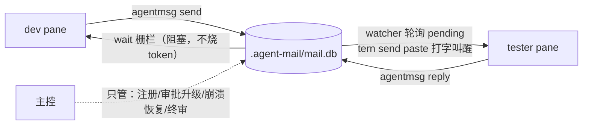

# agentmsg 方案：项目内智能体信箱（SQLite 单文件，零依赖）

> 版本：**v2.1（2026-10-15 可靠性评审后）**，交付物：`agentmsg.py`（单文件，仅 Python 标准库）+ `test_agentmsg.py`（28 项回归）
> 配套：tern 编排 skill（`.claude/skills/tern/SKILL.md`）

---

## 1. 要解决的问题

- 多个 coding agent（dev / tester / reviewer…）分处 Tern 的不同 pane，**互相不认识、无法直接通信**；
- 若所有消息都经主控（人的 AI 会话）转手，**每跳都烧主控 token**，且主控成为吞吐瓶颈；
- agent 可能忙、卡死、宿主机死机——**消息不能丢，状态不能永久僵死**。

## 2. 架构总览

**核心原则：DB 是账本，Tern 是邮路；判死靠表里的事实 + 时间差，不靠任何进程的记忆。**



- **pane 里的 agent 不会被信箱叫醒**——idle 在提示符时只有键盘输入能唤醒它。所以物理投递永远是"往 pane 打字"（tern send paste + keys enter），这一步由 watcher 代劳，主控退出日常链路。
- **轮询只发生在进程内**（watcher / wait 命令），agent 的 token 只在命令返回时消耗。
- **队列本身就是忙态缓冲**：给忙的 agent 发消息不需要等它空闲，投递时机由 watcher 处理。*"先查对方状态、忙就轮询到空闲"* 这个流程是不必要的——队列已经吸收了忙态；轮询留给"等回音"（`wait` 栅栏）。

### 角色与两种模式

| 模式 | pane 里跑的是 | 谁操作 mail.db | 谁物理投递 |
|---|---|---|---|
| A（默认） | 裸 codex/claude CLI | 主控代劳（agent 不知信箱存在） | watcher / 主控 |
| B（自治） | 自带 shell 能力的 agent | agent 自己 inbox/read/reply | watcher（叫醒用 paste "查收信箱"） |

主控的保留职责：注册 agent、审批类升级（blocked 界面）、崩溃后的 sweep 恢复、终审（重派/退回）。

### 2.1 核心不变量（本体承诺）

机制的一切操作（SOP）都踩在这五条承诺上；违反任何一条，对应链路即失效。

1. **DB 是唯一真相**——任何组件（agent/pane/宿主机）都可以死；状态判定 = 表里的事实 + 时间差，重启后真相互原，不靠任何进程的记忆。
2. **屏幕不是契约**——内容回收只认落库记录（`read/inbox/wait`）；读屏（capture / agent read）是按需排障工具，不是监控，也不作为工作证据（可见性与功能解耦，详见 `docs/observation-discipline.md`）。
3. **落库即完成**——消息写入即送达成功，与收件方当前状态完全解耦；这是水位线异步消费（§5.5）与忙态缓冲的根据。
4. **回执是可选层**——`send` 底座是数据报（§5.4）；`wait/reply/thread` 是按需建筑，不需要反馈就别建。
5. **忙时注入 = 事故**——向 pane 打字前必须有安检：静默门（idle）是所有 agent 的兜底，屏检词表仅对有审批框的 agent（claude 类）生效。

本体词汇表 = §3 表结构 + §5.5 模式清单；SOP 时序展开 = 两个 skill 的黄金集（G1–G10）。名词归本体，动词归时序——文档按此分工，不互相复述。

## 3. 表结构（4 张表）

```sql
-- 智能体基本信息 + 当前状态 + pane 绑定（tag 寻址的核心：名字 → tern_block_id）
CREATE TABLE agents(
  id INTEGER PRIMARY KEY,
  name TEXT UNIQUE NOT NULL,        -- 'dev' / 'tester'，收发地址
  kind TEXT,                        -- claude / codex / pwsh…
  tern_block_id INTEGER,            -- 绑定的 Tern pane（watcher 据此打字）
  state TEXT,                       -- idle|working|blocked|done|offline
  state_updated_at TEXT,            -- 心跳时间戳，活性判断依据
  created_at TEXT NOT NULL DEFAULT (datetime('now'))
);

-- 任务表：谁在干什么
CREATE TABLE tasks(
  id INTEGER PRIMARY KEY,
  title TEXT NOT NULL,
  assigned_to TEXT,
  state TEXT NOT NULL DEFAULT 'queued',  -- queued|running|blocked|done|failed
  created_at TEXT NOT NULL DEFAULT (datetime('now')),
  updated_at TEXT NOT NULL DEFAULT (datetime('now'))
);

-- 队列 + 历史一体：status 是队列位置，行本身就是历史记录
CREATE TABLE messages(
  id INTEGER PRIMARY KEY,
  sender TEXT NOT NULL,
  recipient TEXT NOT NULL,          -- "tag"：收件 agent 名
  thread_id TEXT NOT NULL,          -- 问答配对 / 多轮追溯
  kind TEXT NOT NULL DEFAULT 'note',-- note|request|reply
  subject TEXT,
  body TEXT NOT NULL DEFAULT '',    -- 短文本；大内容走 payload_path
  payload_path TEXT,                -- 附件（.agent-mail/attachments/）
  status TEXT NOT NULL DEFAULT 'pending', -- pending|delivered|read|done|expired
  created_at TEXT NOT NULL DEFAULT (datetime('now')),
  delivered_at TEXT, read_at TEXT, done_at TEXT
);

-- 状态流水（历史），保留近 30 天
CREATE TABLE status_log(
  id INTEGER PRIMARY KEY,
  agent TEXT NOT NULL,
  state TEXT NOT NULL,
  detail TEXT,
  created_at TEXT NOT NULL DEFAULT (datetime('now'))
);
```

设计要点：

- **messages 不拆队列表/历史表**——status 列就是队列位置，已完成的行留表 30 天即成历史，查询路径只有一条；
- **agents.state（当前值）与 status_log（流水）分离**——当前态供路由判断，流水供审计且 30 天自动清；
- 大内容（diff/日志）一律 `--file` 存附件，DB 只留路径，防 blob 膨胀；
- `.agent-mail/` 加入 `.gitignore`（运行时状态，block id 每会话都变）。

## 4. CLI 参考（`agentmsg.py`）

```bash
python agentmsg.py [--db PATH] <子命令>      # 默认 db：<cwd>/.agent-mail/mail.db

init                                        # 进新项目第一步（建库+WAL，幂等）
register NAME [--kind K] [--block ID]       # 注册/更新，register 即心跳
agents [--json]                             # 路由表：名字→pane，含 state + stale 标记

send FROM TO [BODY] [--kind note] [--thread T] [--subject S] [--file F]
                                            # BODY 省略时读 stdin；收件人须已注册或 human
inbox AGENT [--all] [--json]                # 收件箱（默认只看 pending）
read ID [--json]                            # 全文 + 标记 read
reply ID BODY                               # 自动继承 thread，回给原发送者
done ID                                     # 标记完成
wait TO --expect N --after-id ID [--kind K] [--timeout 600] [--json]
                                            # 栅栏：阻塞到 N 封到达；超时 exit 124
status AGENT STATE [DETAIL]                 # 状态跃迁：写 status_log + 刷 agents 心跳
log [AGENT] [--days 30] [--json]            # 查状态流水
sweep                                       # 把超租约(15分钟)的 agent 判死置 offline
task new TITLE [--assign NAME] | task list [--state S] | task set ID STATE [--assign NAME]

watch NAME [--interval 5] [--once]          # 投递器：常驻轮询 或 --once 适合 cron
```

## 5. 消息流转协议

### 5.1 投递（watcher 的认领式投递）

```
轮询 pending → 原子认领（UPDATE … SET delivered WHERE id=? AND status='pending'，
rowcount=1 才算抢到，多 watcher 并发不重复投）→ tern send paste + keys enter
→ 成功：标记 delivered；失败：退回 pending
```

投递是**拉模式**：消息先落库，watcher 死了消息原地等待，重启继续投——所以 watcher 可以常驻，也可以 cron 每 30 秒跑一次 `--once`。

### 5.2 典型场景：dev 直接找 tester 沟通

```bash
# dev（或替 dev 的 watcher）：
agentmsg send dev tester "联调下登录接口" --kind request   # 投进队列即返回，不等对方空闲
agentmsg wait human …  # 仅当 dev 下一步依赖 tester 回音时才等：阻塞，不烧 token

# watcher（tester 的邮差，cron 或常驻）：
agentmsg watch tester --once                              # 把 pending 打字投进 tester 的 pane

# tester 醒来干活，回信（Mode B 自己跑；Mode A 由主控 capture后代笔）：
agentmsg reply <收到的msg id> "接口OK，测试报告见附件" --file report.md
```

### 5.3 主控多路合并（fan-in 栅栏）

```bash
agentmsg send human coder   "实现登录接口"    # msg 1
agentmsg send human reviewer "review abc"    # msg 2
agentmsg wait human --expect 2 --kind reply --after-id 2 --timeout 600 --json
# 齐了 → 一次性拿到两封 JSON → 主控合并思考 → 产物分投各 agent（thread 不断链）
```

`--after-id` 用单调递增的 msg id 而非时间戳：从 `send` 的输出直接拿，无时区问题。

### 5.4 单向通知（UDP 语义：发完即走，不要回执）

`send` 本身就是数据报：插库即返回（`ok: msg N`），协议**不强制 reply**。回执层（`wait`/`reply`/`thread`）是可选建筑；不需要反馈就不用它。

```bash
agentmsg send dev tester "部署完成，通知而已" --kind notify   # kind 自由字段，标 notify 与请求类区分
# 投递照常（watch 或手投），通知话术声明"读完即可，无需回复"
```

纪律：
- **发送方**：发完即走——不调 `wait`、不查 `inbox`；真要确认送达时才回头 `read <id>` 看 status（pending→read）。
- **接收方**：通知类消息 `read` 后**不回信**；想让它从 pending 列表消失就补 `done <id>`（只翻状态、不产生消息）——这是唯一值得做的"ACK"。
- **广播** = 循环 N 次 `send`（每收件人一封，天然隔离），不为它建 broadcast 命令。
- 与真 UDP 的差别：**不丢包**——消息持久化到被 read 为止，是"必达但不用等"，不是 best-effort。

### 5.5 拓扑与消费模式（模式清单）

**树形递归 fan-out/fan-in**（一分二、二分四逐级下传）：每个节点跑同一套动作——向 N 个孩子各 `send`（不带 `--thread`，各自新线程天然隔离）→ `wait <我> --expect N --after-id <最后发出的id>` 等齐 → 汇总后 `reply` 父节点。同步屏障与异步放行可逐层混用：要等齐的层用屏障，纯通知的层换 §5.4 notify。

**水位线异步消费**（A 派活后不等，各干各的）：B 的回信**落库即完成**，与 A 的状态完全解耦；投递只在 A 空闲时发生（忙时 watch 自动 skip、保持 pending），消息不会丢。A 干完自己的活后凭水位线一次性补读：`wait <A> --after-id <上次处理的msg id>`（或 `inbox <A>`）——`--after-id` 就是断点游标，消费过的不重拿，这正是它存在的原因。

**模式清单**：

| 模式 | 语义 | 组合原语 | 参考 |
|---|---|---|---|
| 请求-回执（同步屏障） | 发出后阻塞等回信，齐了才走 | `send` + `wait --expect --after-id [--thread]` | §5.2，G8 |
| 单向通知（UDP） | 发完即走，无回执 | `send --kind notify`；接收方 `read` + 可选 `done` | §5.4 |
| fan-in 栅栏 | 多源回信合并后再决策 | `wait --expect N --kind reply --after-id` | §5.3，G9 |
| 树形递归 | 树状逐级下传、逐级汇合 | 屏障逐层复用，thread 隔离 | 本节 |
| 水位线异步消费 | 收发双方时间解耦，闲时补读 | 持久化收件箱 + `--after-id` / `inbox` | 本节 |
| task 派单 | 系统级任务台账，状态可查 | `task new --assign` + 通知叫醒 + `task set done` | G10 |

不支持且暂不做（触发条件到了再建）：**主题广播**（一条消息 N 订阅者，现用循环 send）；**系统级 DAG 汇合**（task 表无父子链接，汇合靠各节点 `wait --expect` 编排；树深且动态再加 `parent_task_id`）。

## 6. 可靠性：四层防线（死机/卡死怎么办）

**设计原则：任何组件都可以死，真相只在 DB。状态判定 = 表里的事实 + 时间差，重启后真相互原。**

| 层 | 机制 | 实测 |
|---|---|---|
| ① 保消息 | pending 永不清理；watcher/机器死掉，队列原样在 DB，重启继续投 | ✓（watch 崩溃后再次 --once 照常投出）|
| ② 保活性 | 每次状态变更刷 `state_updated_at` 心跳；超 15 分钟 = stale，`send` 自动警告但**消息照收**（怀疑≠拒收） | ✓（心跳回拨 20 分钟触发 warn）|
| ③ 保恢复 | `sweep` 一条命令把所有超租约 agent 判死置 offline；重启后先 sweep 再开工 | ✓（判死 1 个）|
| ④ 终审 | offline agent 的任务标 failed、pending 消息重派或退回——留给人/主控裁决，不自动毁灭 | 约定 |

辅以两层工程保险：

- **原子认领**防重复投递（见 5.1）；
- **SQLite 硬化**（依据 [Zylos WAL 坑文](https://zylos.ai/en/research/2026-02-20-sqlite-wal-mode-ai-agent-systems)）：
  `journal_mode=WAL` + `busy_timeout=5000` + `synchronous=NORMAL`；写事务一律 `BEGIN IMMEDIATE`（防 SQLITE_BUSY_SNAPSHOT）；只放本地盘（WAL 不兼容网络文件系统）；短连接形态天然免疫 checkpoint 饥饿。

## 7. Token 经济学

| 链路 | token 消耗点 |
|---|---|
| 旧：一切经主控 | 每跳消息 = 主控读+写（最贵） |
| 新：watcher 直连 | 日常消息 **0 主控 token**（watcher 是无 AI 的普通进程）；agent 只在干活/被叫醒时消耗 |
| 等待/轮询 | 都在 CLI 进程内（wait / watch），返回才算一次工具调用 |
| 主控只承担 | 注册、审批升级、sweep 恢复、终审——低频高价值动作 |

## 8. 部署

```bash
# 一次性：把 agentmsg.py 放进 PATH 或固定目录（零依赖，无需安装）
# 每个项目：
python agentmsg.py init
echo ".agent-mail/" >> .gitignore
# split 新 agent pane 后，编排方一行注册（id 就在手边，不让 agent 自探测）：
tern run <新block-id> "python agentmsg.py register <名字> --kind claude --block <新block-id>"
# 投递器二选一：
agentmsg watch <名字>                     # 常驻（独立终端/后台）
# 或 crontab：*/1 * * * * python agentmsg.py watch <名字> --once
```

约定：**任务正文永远不要写死 msg id**（发送时 id 未定）——通知里带真实 id，agent 按它取信。

## 9. 实测验证记录（2026-10-15，全部通过）

| 验证项 | 结果 |
|---|---|
| 生命周期 init→register→send→inbox→read→reply→done | ✓ |
| 收件人拼写错误拒绝并列出已注册名单 | ✓ |
| 30 天保留：40 天前 status/done 数据被懒清理，近期保留 | ✓ |
| `integrity_check` | ok |
| 5 进程并发写 | 5/5 成功零丢失 |
| **真实 Tern pane 端到端**：dev send → watch 投递 → pwsh 执行消息内容 → capture 抓到输出 → 状态 pending→delivered | ✓ |
| 旧库迁移（delivered_at 列 ALTER 补齐） | ✓ |
| stale 警告（心跳停 20 分钟） | ✓ |
| sweep 判死 offline | ✓ |
| wait 栅栏：双回信到齐一次取全；超时 exit 124 | ✓ |

## 10. v2.1 可靠性增量（评审修复记录）

### 10.1 消息状态机（修正后）

```
pending →(原子认领: claimed+租约2min+claim_token)→ claimed →(capture安检→通知注入)→ delivered → read → done
              ↓ 租约过期(recover_claims 懒回收)            ↓ 安检不过/投递失败
            pending ←────────────────────────────────  revert(带 token fence)
```

- **claimed 中间态**：认领与注入之间崩溃不再滞留——租约 2 分钟（paste 上限 ~30s）内由下一次任何命令懒回收重投（`recover_claims`，connect() 内联）。
- **claim_token fencing**：只有租约仍归属本 token 才能落 delivered/回退；被回收重认领后，旧持有者的 finalize 是 no-op（防复活消息被二次标记）。
- **语义边界（不宣称 exactly-once）**：pending=入库；delivered=**Tern 接受了输入**；read=agent 取信；done=任务处理完成。paste 成功→标记 delivered 之间的崩溃仍可能造成重投（at-least-once），去重靠消息 id 在 agent 侧幂等——已知残余风险，见 11.4。

### 10.2 Tern 输入安全（watcher 投递协议）

1. **只注入固定通知，不注入正文**：`[agentmsg] 新消息 msg {id} 来自 {sender}（{kind}）：{≤100字符预览}` + `取信: agentmsg read {id}`。正文经 inbox/read 获取；正文长尾绝不进 pane（有回归测试）。
2. **注入前 capture 安检**：pane 画面命中审批/提问特征（`do you want`/`allow`/`approve`/`permission`/`(y/n)`/`❯`/`esc to` 等，启发式非保证）→ 跳过本轮、消息保持 pending，稍后重试。实测：pane 卡在真实提问界面时 0 键注入。
3. **单例锁**：`.agent-mail/watch-{name}.lock`（O_EXCL+pid），同 pane 双 watcher 并发 paste 会交叠 → 拒绝第二个。Ctrl-C 正常退出释放；**硬杀残留锁**：10 分钟后可被接管，或人工删除文件（恢复预案）。
4. **失败退回**：tern 命令任何失败（含 pane 已死）→ 带 token 回退 pending + warn，`--once` 模式停手（修复了 v2.0 失败即无限重试的死循环）。

### 10.3 活性与身份

- **sweep 豁免 working**：长任务数小时不碰信箱不会被误判死；静默的 working 靠 agents 列表 stale 标记 + tern capture 由主控裁决。
- **重绑即新会话**：`register --block 换新 id` → state 重置 idle（旧会话状态不带到新 pane）；不带 --block 的 register 只改 kind，状态保留。
- **watcher 每次投递重读绑定**：中途重绑立即生效，旧 watcher 不会往旧 pane 打字。

### 10.4 已知残余风险（明确列出，不装不存在）

| 风险 | 现状 | 触发条件/缓解 |
|---|---|---|
| paste 成功后、标记 delivered 前崩溃 → 重投（重复通知） | at-least-once，无 pane 侧 ack 无法消除 | 租约 2min 远大于 paste 耗时，仅真崩溃触发；重复无害（通知幂等，id 可去重） |
| capture 安检漏报（未收录的审批 UI 文案） | 启发式清单，非保证 | 通知本身无害且幂等；新 UI 文案出现后加进 `APPROVAL_MARKERS` |
| ~~安检对备用屏型 TUI 失明~~ **归因修正（2026-10-15）**：受控实验证明 tern capture 本就跟随活动屏（1049/2026 均可见）；omp 不可见是其**应用侧渲染路径**问题（帧未进 tern 文本模型，根因待源码调查，见 tern-capture-active-spec.md §8）。运营上 omp 自动放行无审批框，且静默门已兜住忙时注入。**补充（二轮外测）**：omp 并非全盲——idle 提示符行（`❯`）capture 可见，盲的是干活时的帧 | 盲区远小于原判断 | 待 omp/tern 源码级定位；claude 侧 capture 安检已实证有效 |
| ~~裸 `❯` 词表永久卡死 omp 投递~~ **外测发现即修（2026-10-16）**：omp 空闲提示符就是 `❯`，裸 substring 匹配使 omp 的 watch 永远 skip（测评员被迫手投）。已改为 `❯ 1.`（claude 审批框选项行精确特征）+ omp idle 提示符回归用例；per-kind 词表待第三个真需求再加 | omp watch 恢复可用 | claude 审批检测仍由 do you want/allow/❯ 1. 承担；新增审批 UI 文案时先想"它是否也是某 agent 的常态屏" |
| ~~claude auto mode 卡权限门~~ **已解决（2026-10-16）**：改用 `claude --permission-mode bypassPermissions` 启动 agent pane，实测全协议闭环（read→reply→done，还会自报状态）。安检词表同步修正：移除裸 `permission`（claude 状态栏 "bypass permissions on" 会永久误杀），审批检测由 `do you want`/`allow`/`❯ 1.` 承担 | claude 成为协议执行最标准的 agent | bypass = 用户显式选择信任 pane 内 agent；词表新增文案时注意勿收录模式指示词 |
| 硬杀 watcher 留下 fresh 锁，10 分钟内新 watcher 被拒 | 设计使然（防交叠优先） | `rm .agent-mail/watch-*.lock` 或等 10 分钟接管 |
| synchronous=NORMAL 断电丢最近写入 | WAL+NORMAL：进程崩溃安全，断电窗口存在 | 消息总线可容忍；要更强改 `PRAGMA synchronous=FULL` 一行 |
| pwsh 等 shell pane 会把通知行当命令报错 | 预期行为（对 claude/codex pane 是下一条用户消息） | shell 型 agent 建议由脚本消费通知 |

### 10.5 人工验证清单（2026-10-15 真机复核完成）

1. ✅ **真实 agent pane 忙碌时的投递语义**（真 claude pane + 真 omp pane 实测）：忙碌/回合中画面命中安检词表（`allow`/`esc to`），watcher 跳过保持 pending；空闲时通知注入并被 agent 正确消费。
2. ✅ **真实审批界面文案命中**：真 claude 权限等待画面 `pane_unsafe=True`（命中 `allow`、`esc to`），0 键注入。
3. ⏸ **断电持久性**：`synchronous=NORMAL` 仅保证进程崩溃安全；断电窗口需真机断电验证（未测）。

**真机全链路记录**：通知投递 → agent 自行 `agentmsg read` → `agentmsg reply` 落库 → 主控 `wait`/`inbox` 收取。claude（批准一次权限后 PONG ✅）；omp（零干预全自动 PONG ✅）。claude 的 auto-mode 分类器不可用时会卡自身权限门——环境问题，非 agentmsg 缺陷，恰好被安检正确兜住。

### 10.6 v2.1 测试与验证结果

- `test_agentmsg.py`：28/28 通过（git-bash 与原生 PowerShell 双环境），1.9s，全 mock 不碰真实 pane。
- 真实 Tern 冒烟（独立 session，不碰用户 pane）：通知注入 ✅、审批界面跳过 ✅（0 键注入）、错误 pane 退回 pending ✅、双 watcher 并发锁拒绝 ✅、硬杀残留锁按预案恢复 ✅。
- 修复前复现证据：v2.0 代码上 8 FAIL + 5 ERROR + 2 挂死（错误 pane 无限重试死循环）。


## 11. 已知边界与演进（按需，未做）

- **watcher 无 pane 空闲检测**：若 agent 正在干活的窗口被投信，文本会排在它的提示符缓冲里——当前靠"认领+失败退回"与人工节奏兜底，出现误投案例再加 idle 检测（缓冲判定思路）；
- **stale 租约固定 15 分钟**（`STALE_MINUTES` 常量），要可调再加 `--stale`；
- 生命周期五态状态机（idle/working/blocked/done/unknown 的自动识别）需 Tern 源码权限，当前以 tern skill 的"capture 判定约定"替代；
- 借鉴清单：[MCP Agent Mail](https://github.com/Dicklesworthstone/mcp_agent_mail)（文件预约/锁，多 agent 同改文件时加）、[agent-inbox](https://github.com/salimfadhley/agent-inbox)（消息模型标准化）、[sqliteq](https://github.com/Minnzen/sqliteq)（visibility timeout/fencing，若任务并发领取变复杂时加）；
- 明确不做：消息优先级、跨批次聚合——出现真实痛点再加。
